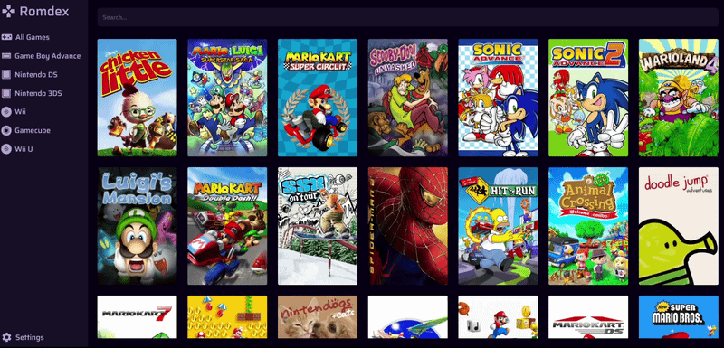

<br>

### Your personal rom collection shelf

<br><br>
<br>

## Summary

I always wanted a way to store my legally dumped ROMs in a nice web interface<br>
with the ability to download its files (game, updates, content) when needed without<br>
any complex user interface, useless features or functions such as emulators launcher.<br><br>
So that's why I build this app to do exactly like that.

## Features

- View games in a card layout
- Order games by console
- Search for games
- Download game files
- Steamgrid integration
- Custom graphical assets

## Preparation

To use this app, you need to put your game files in a certain folder structure<br>
organized by consoles, games and type of content available.<br><br>
Example:

```
Games
├───Console 1
│   └───Game 1
│       └───game
│             └─rom.file
│
└───Console 2
    ├───Game 1
    │   ├───game
    │   │     └─rom.file
    │   └───update
    │         └─rom.file
    │
    └───Game 2
        ├───game
        │     └─rom.file
        │
        └───content
              └─rom.file
```

Consoles and games needs to be properly named so they can be identified by the program and/or Steamgrid.<br>
Here's the list of consoles currently in the application.<br>

- NES
- SNES
- Game Boy
- Game Boy Advance
- Nintendo DS
- Nintendo 3DS
- Wii
- Gamecube
- Wii U
- Switch
- Switch 2
- PlayStation
- PlayStation 2
- PlayStation 3
- PlayStation 4
- PlayStation 5
- PSP
- PS Vita
- Xbox
- Xbox 360
- Xbox One
- Xbox Series
- Master System
- Mega Drive
- Sega CD
- Game Gear
- Dreamcast
- Neo Geo
- Neo Geo Pocket
- Philips CD-i
- Mobigo
- V.Smile

Types of games files needs to be in a certain folder to be able to be properly shown on the app.<br>
Here's the list of folder names supported by the application.<br>

| Name      | Description    |
| --------- | -------------- |
| game      | Game           |
| encrypted | Encrypted game |
| decrypted | Decrypted game |
| update    | Update         |
| content   | DLC            |
| demo      | Demo           |

You can still place the ROM files in a custom named folder and it will be picked by the application without any issues.

## Installation

To install this you need:

- Docker
- Docker Compose (optional)

Using a docker-compose.yml file

```
services:
  romdex:
    image: straky/romdex:latest
    ports:
      - "8080:8080"
    environment:
      steamgrid_key: "<api_key>"
    volumes:
      - <path_to_games>:/games
    init: true
    restart: unless-stopped
```

Using docker run

```
docker run -d \
  --name romdex \
  -p 8080:8080 \
  -e steamgrid_key="<api_key>" \
  -v <path_to_games>:/games \
  --restart unless-stopped \
  straky/romdex:latest
```

You will be able to access the application with this URL

```
http://<server_ip_address>:8080
```